# Art Direction Brief — Calon Arang: Bayang-Bayang Girah

> **Status:** DRAF v3 — usulan, belum disetujui kelompok.
> Versi ini mengganti arah visual menjadi **2.5D** (pixel art dengan kedalaman, cahaya, dan
> efek kamera), dengan sudut pandang dari depan dan palet yang lebih redup.
> Semua angka, warna, dan aturan di dokumen ini boleh diubah. Setelah disetujui,
> perubahan berikutnya dicatat di bagian [Riwayat perubahan](#riwayat-perubahan).

Dokumen ini adalah "kontrak visual" game. Tujuannya supaya semua asset — buatan sendiri,
hasil Codixel, atau asset gratis — terlihat berasal dari satu game yang sama.

File pendamping di folder ini:

| File | Isi |
|---|---|
| `palette-girah.gpl` | Palet resmi (64 warna) untuk di-import ke Pixelorama / LibreSprite / GIMP |
| `palette-girah.hex` | Palet yang sama, format Lospec (satu hex per baris) |
| `palette-girah.png` | Palet 64×1 pixel (bisa di-import sebagai palet gambar) |
| `palette-girah-preview.png` | Pratinjau palet berlabel, dikelompokkan per ramp |
| `swatch/` | Kotak warna kecil untuk tabel palet di Bagian B4 |
| `layout-battle.png` | Wireframe layar battle 640×360 (disimpan 2× = 1280×720) |
| `layout-cerita.png` | Wireframe layar cerita/dialog 640×360 (disimpan 2×) |
| `mockup/` | Gambaran sementara layar game (lihat di bawah) |
| `asset-manifest.json` | Daftar semua asset + status pengerjaan |
| `prompt-card.md` | Template prompt untuk Codixel |
| `style-board.png` | **BELUM ADA** — visual target, lihat [Bagian D](#d-visual-target) |
| `do-dont.png` | **BELUM ADA** — contoh boleh/tidak boleh, lihat [Bagian D](#d-visual-target) |

Folder `referensi asset/` di root repo berisi gambar referensi dari internet (screenshot game,
foto desa Bali, foto Rangda, ilustrasi). Gambar-gambar itu **hanya untuk referensi** dan tidak
boleh dimasukkan ke game atau di-trace.

---

## Gambaran visual (mockup sementara)

> Mockup dibuat otomatis dengan kode: lapisan pixel art 640×360 dari palet 64 warna, diperbesar
> 2×, lalu diberi efek kamera (blur kedalaman, cahaya bersinar, kabut, vignette) seperti yang
> nanti dibuat dengan shader di LibGDX. Tujuannya memberi **gambaran suasana, kedalaman, dan
> tata letak** — bentuk karakter dan bangunan masih sederhana dan akan diganti asset buatan kelompok.

**Layar cerita (ramai)** — Babak 2, Desa Girah saat senja. Gapura bata, bale beratap jerami,
penjor, pohon kamboja, warga, dan kelompok pengelana di jalan desa; dialog gaya Persona di atasnya.

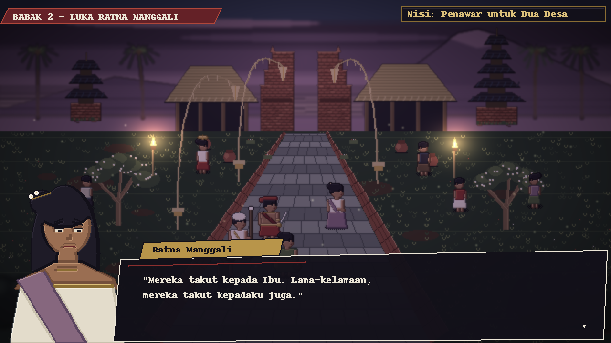

Versi tanpa dialog (diorama saja): `mockup/mockup-adegan-tanpa-dialog.png`.

**Layar battle siang (lenggang)** — Babak 1, tanah lapang di Hutan Beringin. Pepohonan dan arca
didorong ke tepi dan ke latar, tengah arena kosong.

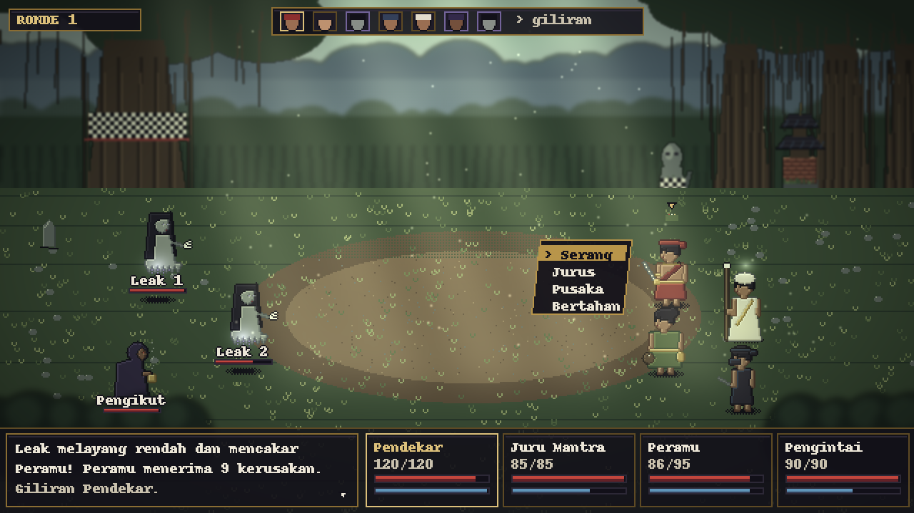

**Layar battle malam (lenggang)** — Babak 5, pelataran pemakaman dekat Candi Durga. Calon Arang
dalam wujud ritual, cahaya dari altar dan obor.

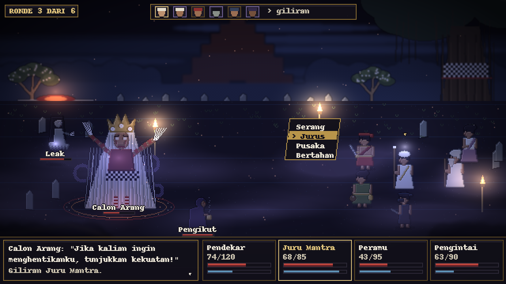

---

## A. Kerangka game

| Poin | Keputusan |
|---|---|
| Judul | Calon Arang: Bayang-Bayang Girah (`GirahGame.JUDUL` di kode masih "Bayang-Bayang Girah") |
| Genre | RPG naratif dengan pertarungan berbasis giliran |
| Fantasi pemain | Empat pengelana menyelidiki wabah di Kerajaan Daha, menolong warga, dan menentukan nasib Calon Arang |
| Gaya visual | **2.5D**: sprite pixel art di dalam lingkungan yang punya kedalaman, cahaya, dan efek kamera |
| Referensi gaya | *Octopath Traveler 2* (kedalaman dan efek kamera), *Graveyard Keeper 2* (warna tanah yang redup dan lingkungan padat), *Final Fantasy Resonance* (tata letak battle). Yang diambil hanya **teknik dan suasananya**, bukan aset, karakter, atau tampilan khas game tersebut |
| Suasana | Mistis, muram, kurang berwarna dibanding Octopath Traveler 2 (tidak sehangat itu). Tragedi seorang ibu, bukan kisah monster |
| Latar | Kerajaan Daha dengan **perpaduan arsitektur Jawa Timur kuno (Majapahit) dan Bali** — lihat B5 |
| Sumber cerita | Terinspirasi *Cerita Calon Arang* karya Pramoedya Ananta Toer |
| Engine | LibGDX 1.14.2, desktop (LWJGL3) |
| Resolusi | Pixel art digambar di **640×360**, diperbesar **2×** ke 1280×720, lalu efek kamera diterapkan di 1280×720 |

### A1. Sudut pandang

- **Dari depan dengan kamera agak menunduk** (seperti diorama dilihat dari depan-atas, ±30°).
  Lantai/tanah terlihat menjauh ke belakang; bangunan dan pohon digambar tampak depan.
- Karakter digambar **tiga-perempat menghadap kamera** (wajah terlihat), condong ke kiri atau kanan.
- Tidak ada sudut isometrik dan tidak ada tampak atas penuh.

### A2. Dua jenis layar

| Layar | Isi | Kepadatan |
|---|---|---|
| **Layar cerita** | Diorama lokasi (latar berlapis + properti + sprite tokoh berdiri di dalamnya) + dialog gaya Persona (potret setengah badan besar di samping kotak dialog miring) + menu pilihan | **Ramai** — banyak properti, warga, dan detail |
| **Layar battle** | Diorama arena: pihak Girah di **kiri** menghadap kanan, pengelana di **kanan** menghadap kiri | **Lenggang** — tengah arena kosong, properti hanya di tepi dan latar |

> **Keputusan terbuka:** draf ini masih mengasumsikan pemain **tidak** berjalan bebas di peta.
> Sprite tokoh di layar cerita cukup diam (idle) atau berpindah singkat lewat skrip. Kalau
> kelompok ingin eksplorasi bebas, dibutuhkan sprite jalan 4 arah, collision, dan sistem peta.

> **Perubahan dari v2:** sisi battle dibalik. Pengelana kini di **kanan**, mengikuti kebiasaan
> genre (Octopath, Final Fantasy) dan supaya kartu status di kanan bawah dekat dengan tokohnya.

### A3. Nama kelompok pengelana

| Peran di cerita | Kelas Java | Jurus |
|---|---|---|
| Pendekar | `Senopati` | Tebasan Keris Pusaka |
| Peramu | `Balian` | Ramuan Penawar |
| Pengintai | `TelikSandi` | Langkah Bayangan |
| Juru Mantra | `Wiku` | Mantra Lingkar Suci |

> **Keputusan terbuka:** nama yang tampil di layar. Draf ini memakai nama **cerita**.

### A4. Adegan per babak

| Babak | Layar cerita (ramai) | Layar battle (lenggang) |
|---|---|---|
| 1 — Bisik-bisik Girah dan Wabah Daha | Balai Kerajaan Daha; Desa Tapak Wangi (rumah Janda Wening) | Tanah lapang Hutan Beringin |
| 2 — Luka Ratna Manggali | Desa Girah, halaman rumah Calon Arang; desa-desa terdampak | — |
| 3 — Petunjuk Dewi, Siasat Bahula | Istana Daha; pertapaan Lemah Tulis; persiapan pernikahan di Girah | (opsional) halaman pertapaan |
| 4 — Kitab yang Dicuri | Dalam rumah Calon Arang; desa diserang | Jalan desa yang diserang |
| 5 — Pertarungan di Girah | Pemakaman dekat Candi Durga (konfrontasi) | Pelataran pemakaman Candi Durga, 3 fase |
| Ending & epilog | Tiga ending di pemakaman; epilog di Tapak Wangi | — |

### A5. Pertarungan akhir (Babak 5)

| Fase | Tujuan pemain | Ancaman | Kebutuhan visual |
|---|---|---|---|
| 1. Penjaga ritual | Kalahkan pengikut dan makhluk gaib | Kabut mengurangi akurasi | Lapisan kabut tebal di arena |
| 2. Tanding sakti | Bantu Mpu Bharadah menghadapi Calon Arang | Kutukan dan serangan gaib | Calon Arang **berubah ke wujud ritual**; lingkar perlindungan Bharadah |
| 3. Ritual terakhir | Hancurkan sumber ritual sebelum batas giliran habis | Kerusakan berkala | Altar menyala makin terang, warna arena bergeser ke merah |

### A6. Cara membuat 2.5D di LibGDX

Ada dua jalan. **Draf ini merekomendasikan Jalan 1.**

| | Jalan 1 — 2.5D tiruan (disarankan) | Jalan 2 — 3D sungguhan |
|---|---|---|
| Cara | Semua tetap 2D: latar dilukis dengan perspektif, disusun dalam **beberapa lapisan**, sprite diurutkan berdasarkan posisi kaki, lalu **shader efek kamera** diterapkan ke seluruh layar | Lingkungan dibuat sebagai model 3D low-poly bertekstur pixel (Blender), sprite karakter dipasang sebagai `Decal` di `PerspectiveCamera` |
| Yang dibutuhkan | `SpriteBatch`, `FrameBuffer`, `ShaderProgram` (GLSL sederhana) | `ModelBatch`, `DecalBatch`, model 3D, pencahayaan 3D, shader |
| Kesulitan | Sedang | Tinggi — butuh kemampuan 3D modeling |
| Cocok untuk tugas kuliah | ✅ | ❌ berisiko tidak selesai |

**Lapisan scene (Jalan 1), dari belakang ke depan:**

| Lapisan | Isi | Efek |
|---|---|---|
| 1. Langit | Gradasi langit, awan, bulan | Blur kuat, bergeser paling lambat (parallax) |
| 2. Latar jauh | Gunung, siluet candi/meru, hutan jauh | Blur sedang, warna memudar ke warna langit (perspektif udara) |
| 3. Latar tengah | Bangunan, pohon besar, gapura | Sedikit blur |
| 4. Bidang main | Tanah/jalan + properti + **sprite tokoh**, diurutkan dari kaki terjauh ke terdekat | Tajam (fokus kamera) |
| 5. Depan | Daun, rumput tinggi, batu di tepi bawah layar | Blur kuat, gelap (bingkai) |
| 6. Cahaya & kabut | Sprite cahaya (additive), partikel debu/kunang-kunang, kabut bergerak | — |
| 7. Efek kamera (shader) | Blur kedalaman atas-bawah (*tilt-shift*), bloom pada sumber cahaya, vignette, color grading | Seluruh layar |
| 8. UI | HUD, dialog, menu | **Tidak** terkena efek kamera |

---

## B. Sistem visual

### B1. Bahasa bentuk

| Pihak / tokoh | Bentuk dasar | Kesan |
|---|---|---|
| **Pengelana** (umum) | Vertikal, tegak, kokoh, sudut membulat | Bisa dipercaya |
| Pendekar (`Senopati`) | Trapesium lebar (bahu besar), keris di tangan, kain merah | Garis depan |
| Juru Mantra (`Wiku`) | Segitiga tinggi (kain putih melebar ke bawah), tongkat panjang | Bijak, sakral |
| Peramu (`Balian`) | Bulat dan lembut, kantung ramuan di pinggang, kain hijau lumut | Penyembuh |
| Pengintai (`TelikSandi`) | Ramping dan condong ke depan, kain gelap, penutup wajah | Cepat, licin |
| **Calon Arang — wujud manusia** | Perempuan tua berwibawa, rambut putih panjang terurai, kain merah ritual | Sakti, murka, **tragis** |
| **Calon Arang — wujud ritual** (Babak 5 fase 2–3) | Sangat lebar: surai putih panjang menjuntai sampai tanah, lengan berbelang merah-putih, kuku panjang, mahkota emas berhias bunga kamboja. **Wajah tetap wajah Calon Arang** dengan riasan ritual, bukan salinan topeng | Mengerikan sekaligus menyedihkan |
| Pengikut Calon Arang | Manusia membungkuk, kain gelap, wajah tertutup bayangan, membawa pedupaan | Fanatik |
| Leak / makhluk gaib | Melayang, rambut panjang menjuntai, cakar, bagian bawah tubuh memudar jadi kabut | Hantu |
| Ratna Manggali | Ramping, sikap menunduk, warna lebih terang dari ibunya | Kesepian, tulus |
| Mpu Bharadah | Tegak, simetris, jubah pertapa putih, janggut putih | Bijak, kokoh |
| Bahula | Muda, sedikit canggung | Ragu |
| Raja Erlangga | Simetris, mahkota dan perhiasan emas | Berwibawa |
| Warga | Sederhana, proporsi biasa, kain dan kebaya pudar | Rakyat yang menderita |

### B2. Prioritas siluet

- Senjata/alat ciri khas tidak boleh menempel di badan.
- Calon Arang wujud manusia dan Ratna mudah dibedakan: ibu lebar dan rambutnya terurai, anak ramping dengan sanggul.
- Di diorama yang ramai, **tokoh harus tetap menonjol** dari latar: latar boleh ramai, tapi nilainya lebih redup dan kontrasnya lebih rendah dari sprite tokoh.
- **Tes siluet:** isi sprite dengan satu warna hitam; semua tokoh di layar yang sama tetap bisa dibedakan.

### B3. Nilai terang-gelap dan kedalaman

- **Perspektif udara:** makin jauh, makin pudar dan makin mendekati warna langit. Latar jauh memakai ramp `Langit`/`Senja`, latar dekat memakai ramp aslinya.
- Bidang main (tempat tokoh berdiri) punya kontras tertinggi.
- Lapisan depan gelap dan buram, berfungsi sebagai bingkai.
- Pihak Girah lebih gelap, dengan titik terang yang menyala (mata, kabut ungu, bara dupa).
- **Tes grayscale:** screenshot hitam-putih — tokoh tetap menonjol.

### B4. Palet dan peran warna

Palet v3 berisi **64 warna dalam 15 ramp**, **lebih redup** dari Octopath Traveler 2 dan dekat
dengan warna tanah Graveyard Keeper 2. Ramp disusun dengan *hue shift*: bayangan bergeser ke
biru/ungu dingin, terang bergeser ke kuning hangat.

**Aturan:**

- Semua sprite, tile, dan latar **hanya** memakai 64 warna ini.
- Efek kamera (cahaya, bloom, blur, kabut, color grading) di runtime **boleh** menghasilkan warna lain — itu bukan pelanggaran.
- Warna paling jenuh (`Api`, `Sistem`, `Merah 4`, `Girah 4`) dipakai **sedikit saja**, sebagai titik fokus.

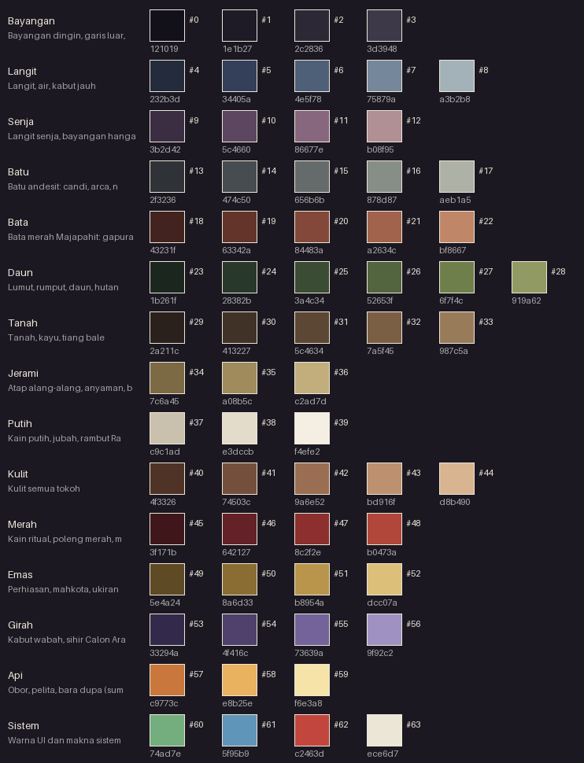

| # | Warna | Nama | Hex | Ramp: dipakai untuk |
|---|---|---|---|---|
| 0 |  | Bayangan 1 | `#121019` | Bayangan: Bayangan dingin, garis luar, malam |
| 1 | 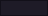 | Bayangan 2 | `#1e1b27` | Bayangan: Bayangan dingin, garis luar, malam |
| 2 | 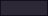 | Bayangan 3 | `#2c2836` | Bayangan: Bayangan dingin, garis luar, malam |
| 3 |  | Bayangan 4 | `#3d3948` | Bayangan: Bayangan dingin, garis luar, malam |
| 4 | 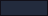 | Langit 1 | `#232b3d` | Langit: Langit, air, kabut jauh |
| 5 |  | Langit 2 | `#34405a` | Langit: Langit, air, kabut jauh |
| 6 |  | Langit 3 | `#4e5f78` | Langit: Langit, air, kabut jauh |
| 7 |  | Langit 4 | `#75879a` | Langit: Langit, air, kabut jauh |
| 8 |  | Langit 5 | `#a3b2b8` | Langit: Langit, air, kabut jauh |
| 9 |  | Senja 1 | `#3b2d42` | Senja: Langit senja, bayangan hangat |
| 10 | 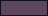 | Senja 2 | `#5c4660` | Senja: Langit senja, bayangan hangat |
| 11 | 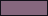 | Senja 3 | `#86677e` | Senja: Langit senja, bayangan hangat |
| 12 |  | Senja 4 | `#b08f95` | Senja: Langit senja, bayangan hangat |
| 13 | 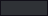 | Batu 1 | `#2f3236` | Batu: Batu andesit: candi, arca, nisan, jalan |
| 14 |  | Batu 2 | `#474c50` | Batu: Batu andesit: candi, arca, nisan, jalan |
| 15 |  | Batu 3 | `#656b6b` | Batu: Batu andesit: candi, arca, nisan, jalan |
| 16 |  | Batu 4 | `#878d87` | Batu: Batu andesit: candi, arca, nisan, jalan |
| 17 |  | Batu 5 | `#aeb1a5` | Batu: Batu andesit: candi, arca, nisan, jalan |
| 18 |  | Bata 1 | `#43231f` | Bata: Bata merah Majapahit: gapura, candi, tembok |
| 19 |  | Bata 2 | `#63342a` | Bata: Bata merah Majapahit: gapura, candi, tembok |
| 20 |  | Bata 3 | `#84483a` | Bata: Bata merah Majapahit: gapura, candi, tembok |
| 21 | 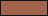 | Bata 4 | `#a2634c` | Bata: Bata merah Majapahit: gapura, candi, tembok |
| 22 | 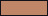 | Bata 5 | `#bf8667` | Bata: Bata merah Majapahit: gapura, candi, tembok |
| 23 | 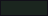 | Daun 1 | `#1b261f` | Daun: Lumut, rumput, daun, hutan |
| 24 |  | Daun 2 | `#28382b` | Daun: Lumut, rumput, daun, hutan |
| 25 | 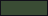 | Daun 3 | `#3a4c34` | Daun: Lumut, rumput, daun, hutan |
| 26 |  | Daun 4 | `#52653f` | Daun: Lumut, rumput, daun, hutan |
| 27 |  | Daun 5 | `#6f7f4c` | Daun: Lumut, rumput, daun, hutan |
| 28 |  | Daun 6 | `#919a62` | Daun: Lumut, rumput, daun, hutan |
| 29 |  | Tanah 1 | `#2a211c` | Tanah: Tanah, kayu, tiang bale |
| 30 |  | Tanah 2 | `#413227` | Tanah: Tanah, kayu, tiang bale |
| 31 | 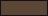 | Tanah 3 | `#5c4634` | Tanah: Tanah, kayu, tiang bale |
| 32 | 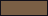 | Tanah 4 | `#7a5f45` | Tanah: Tanah, kayu, tiang bale |
| 33 |  | Tanah 5 | `#987c5a` | Tanah: Tanah, kayu, tiang bale |
| 34 |  | Jerami 1 | `#7c6a45` | Jerami: Atap alang-alang, anyaman, bambu kering |
| 35 |  | Jerami 2 | `#a08b5c` | Jerami: Atap alang-alang, anyaman, bambu kering |
| 36 |  | Jerami 3 | `#c2ad7d` | Jerami: Atap alang-alang, anyaman, bambu kering |
| 37 |  | Putih 1 | `#c9c1ad` | Putih: Kain putih, jubah, rambut Rangda |
| 38 |  | Putih 2 | `#e3dccb` | Putih: Kain putih, jubah, rambut Rangda |
| 39 |  | Putih 3 | `#f4efe2` | Putih: Kain putih, jubah, rambut Rangda |
| 40 |  | Kulit 1 | `#4f3326` | Kulit: Kulit semua tokoh |
| 41 | 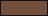 | Kulit 2 | `#74503c` | Kulit: Kulit semua tokoh |
| 42 |  | Kulit 3 | `#9a6e52` | Kulit: Kulit semua tokoh |
| 43 |  | Kulit 4 | `#bd916f` | Kulit: Kulit semua tokoh |
| 44 |  | Kulit 5 | `#d8b490` | Kulit: Kulit semua tokoh |
| 45 | 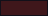 | Merah 1 | `#3f171b` | Merah: Kain ritual, poleng merah, merah tua |
| 46 | 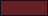 | Merah 2 | `#642127` | Merah: Kain ritual, poleng merah, merah tua |
| 47 | 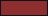 | Merah 3 | `#8c2f2e` | Merah: Kain ritual, poleng merah, merah tua |
| 48 | 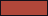 | Merah 4 | `#b0473a` | Merah: Kain ritual, poleng merah, merah tua |
| 49 |  | Emas 1 | `#5e4a24` | Emas: Perhiasan, mahkota, ukiran |
| 50 | 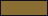 | Emas 2 | `#8a6d33` | Emas: Perhiasan, mahkota, ukiran |
| 51 |  | Emas 3 | `#b8954a` | Emas: Perhiasan, mahkota, ukiran |
| 52 |  | Emas 4 | `#dcc07a` | Emas: Perhiasan, mahkota, ukiran |
| 53 |  | Girah 1 | `#33294a` | Girah: Kabut wabah, sihir Calon Arang |
| 54 |  | Girah 2 | `#4f416c` | Girah: Kabut wabah, sihir Calon Arang |
| 55 | 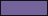 | Girah 3 | `#73639a` | Girah: Kabut wabah, sihir Calon Arang |
| 56 |  | Girah 4 | `#9f92c2` | Girah: Kabut wabah, sihir Calon Arang |
| 57 | 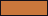 | Api 1 | `#c9773c` | Api: Obor, pelita, bara dupa (sumber cahaya) |
| 58 |  | Api 2 | `#e8b25e` | Api: Obor, pelita, bara dupa (sumber cahaya) |
| 59 |  | Api 3 | `#f6e3a8` | Api: Obor, pelita, bara dupa (sumber cahaya) |
| 60 |  | Penyembuhan | `#74ad7e` | Sistem: Warna UI dan makna sistem |
| 61 |  | Energi batin | `#5f95b9` | Sistem: Warna UI dan makna sistem |
| 62 |  | Nyawa | `#c2463d` | Sistem: Warna UI dan makna sistem |
| 63 |  | Teks UI | `#ece6d7` | Sistem: Warna UI dan makna sistem |

**Makna warna (wajib konsisten):**

- **Merah** = nyawa / damage / ritual (dan Ending 3 — tragis)
- **Biru** (`Energi batin`) = energi batin (dan Ending 1 — pengadilan kerajaan)
- **Hijau** (`Penyembuhan`) = penyembuhan / penawar (dan Ending 2 — pemulihan)
- **Ungu** (`Girah`) = kabut wabah / sihir Calon Arang
- **Emas & api** = cahaya, kesucian, kerajaan

### B5. Latar tempat: perpaduan Jawa Timur dan Bali

Kerajaan Daha digambarkan memakai unsur **Majapahit / Jawa Timur kuno** dan **Bali**, yang memang
punya akar yang sama. Pembagian kasarnya:

| Unsur | Jawa Timur kuno (Majapahit) | Bali | Dipakai di |
|---|---|---|---|
| Gerbang | Gapura bata merah (candi bentar dan paduraksa) | Candi bentar dan angkul-angkul batu paras | Desa, istana, pemakaman |
| Bangunan suci | Candi bata ramping bertingkat | Meru beratap ijuk bertingkat ganjil, pelinggih | Candi Durga, pertapaan |
| Rumah | Pendopo kayu beratap tinggi | Bale beratap alang-alang, tembok penyengker | Desa Tapak Wangi, Girah |
| Material | **Bata merah** tanpa plester, kayu jati | **Batu paras** abu-abu, ijuk hitam, alang-alang | Semua lokasi |
| Hiasan | Relief, arca penjaga (dwarapala), umpak batu | Penjor, umbul-umbul, kain poleng di arca/pohon, canang sari | Semua lokasi |
| Alam | Hutan jati, beringin, gunung berapi berkabut | Sawah terasering, pohon kelapa, kamboja | Hutan Beringin, desa, pemakaman |
| Busana | Kain panjang, selendang, ikat kepala, perhiasan emas | Kamen, udeng, kebaya sederhana, kain poleng | Semua tokoh |

Hindari busana Jawa/Bali modern (blangkon, beskap, kebaya modern berpayet).

### B6. Kepadatan komponen

**Layar cerita = ramai.** Setiap lokasi cerita minimal punya: 1 bangunan utama, 2–3 bangunan
pendukung, 6–10 jenis properti kecil, tanaman di 3 kedalaman, 2–4 warga/NPC, dan 1–2 sumber cahaya.

| Lokasi | Properti utama (contoh) |
|---|---|
| Balai Kerajaan Daha | Pendopo besar beratap sirap, tiang berukir, umpak batu, peta desa di meja rendah, payung kebesaran (tedung), pelita gantung, pejabat berdiri |
| Desa Tapak Wangi | Jalan batu menurun, bale alang-alang, tembok penyengker, angkul-angkul, penjor, lumbung padi, kandang ayam, tempayan air, jemuran kain, sawah di latar |
| Hutan Beringin | Beringin raksasa dengan akar gantung, kain poleng di batang pohon, arca batu berlumut, pelinggih kecil, semak, jamur, berkas cahaya matahari |
| Desa Girah | Gapura bata, bale tua, pagar bambu, pohon kamboja, sesajen, tempayan, warga yang menghindar, rumah Calon Arang di ujung jalan |
| Istana Daha | Paduraksa bata, kolam teratai, arca dwarapala, umbul-umbul, prajurit |
| Pertapaan Lemah Tulis | Bale kecil di tengah hutan, meru beratap ijuk, tangga batu berlumut, pelita, kitab lontar |
| Desa diserang | Kabut ungu di jalan, gerobak terguling, obor, warga berlari, balai desa |
| Pemakaman Candi Durga | Candi bata di balik kabut, nisan tua miring, kamboja, akar beringin, altar dupa, lingkaran ritual |

**Layar battle = lenggang.**

- **Tengah arena kosong** — minimal 60% bidang main tanpa properti.
- Properti hanya di **tepi kiri-kanan** dan di **latar belakang**; lapisan depan memakai daun/batu buram sebagai bingkai.
- Tanah arena polos dengan sedikit tekstur (rumput, batu kecil, jejak tanah), tanpa benda yang bisa dikira rintangan.
- Setiap arena battle punya pasangan lokasi cerita yang sama tetapi **sudah dibersihkan** (misalnya "Hutan Beringin" untuk cerita, "tanah lapang Hutan Beringin" untuk battle).

### B7. Material

| Material | Aturan |
|---|---|
| Bata merah | Ramp `Bata`, garis nat gelap tiap 2–3 pixel, sebagian bata lebih terang/gelap acak, lumut di bagian bawah |
| Batu paras/andesit | Ramp `Batu`, tepi atas lebih terang, lumut `Daun 3–4` di sela |
| Atap alang-alang/ijuk | `Jerami` untuk alang-alang, `Bayangan 2–3` untuk ijuk hitam; garis serat miring |
| Kayu | Ramp `Tanah`, serat vertikal |
| Kain | 2–3 warna dari ramp kain; motif poleng (kotak hitam-putih) hanya pada arca/pohon/Calon Arang |
| Daun | 3–4 warna `Daun` per gumpal, sisi terkena cahaya memakai `Daun 5–6` |
| Kabut / asap dupa | Dithering atau semi-transparan (`Girah`, `Langit 4–5`) |
| Cahaya | Sprite cahaya terpisah (additive), bukan dilukis permanen di latar |

### B8. Garis tepi

- **Sprite tokoh dan properti kecil:** outline 1 pixel memakai warna paling gelap dari ramp di sebelahnya (*selective outline*), atau `Bayangan 1` untuk tepi luar siluet.
- **Latar dan bangunan:** tanpa outline luar; bentuk dibedakan oleh nilai terang-gelap.
- Dilarang: anti-aliasing otomatis, blur di dalam sprite, ukuran pixel campuran.

### B9. Pencahayaan dan efek kamera

| Lokasi | Waktu | Cahaya utama | Warna grading |
|---|---|---|---|
| Balai Kerajaan Daha | Malam | Pelita gantung (hangat) | Emas redup |
| Desa Tapak Wangi | Pagi berkabut | Matahari pucat dari kiri atas | Hijau keabu-abuan |
| Hutan Beringin | Siang | Berkas cahaya menembus daun | Hijau lumut, sedikit kuning |
| Desa Girah | Senja | Langit senja + pelita rumah | Ungu-mauve |
| Pertapaan Lemah Tulis | Fajar | Matahari rendah, kabut | Biru pucat |
| Desa diserang | Malam | Obor + kabut ungu | Ungu-merah |
| Pemakaman Candi Durga | Malam tanpa bintang | Altar dan obor | Biru gelap + merah ritual |

- Sumber cahaya (obor, pelita, altar, mata leak) diberi **sprite cahaya** bulat lembut (additive) dan ikut terkena **bloom**.
- **Blur kedalaman:** sepertiga atas (latar jauh) dan sepersepuluh bawah (lapisan depan) dibuat buram; bidang main tajam.
- **Vignette** di semua layar, lebih kuat di malam hari.
- Partikel: debu cahaya (siang), kunang-kunang (senja/malam), abu dupa (pemakaman).

### B10. Kepadatan detail

- Sprite battle tokoh: kanvas 64×64, tinggi badan ±44 px, kepala ±11 px.
- Detail dipusatkan di wajah, senjata, dan perhiasan.
- Calon Arang wujud ritual (128×128) boleh paling detail: helai surai, belang lengan, mahkota.
- Potret dialog (128×192) adalah tempat ekspresi; bayangan boleh 2–3 pixel.
- Latar boleh sangat detail, **asal** kontrasnya tetap di bawah tokoh.

### B11. Karakter gerakan

| Pihak | Gaya | Timing |
|---|---|---|
| Pengelana | Tegas: ancang-ancang 1 frame → serang → kembali | Serang 4 frame @ 0,08–0,1 s |
| Leak | Melayang naik-turun 1–2 px | Idle 4 frame @ 0,2 s |
| Pengikut | Membungkuk, bergoyang pelan | Idle 4 frame @ 0,2 s |
| Calon Arang | Lambat dan berat; surai dan kain bergerak dengan jeda | Idle 6 frame @ 0,25 s |
| Lingkungan | Daun bergoyang, api berkedip, kabut bergeser | 3–4 frame @ 0,15–0,3 s |

### B12. Larangan

- Tidak ada teks yang "dibakar" ke dalam gambar. Semua teks dibuat oleh kode.
- Tidak ada adegan sadis/berdarah.
- Leak tidak digambarkan sebagai kepala melayang dengan organ dalam.
- **Rangda dan Barong adalah tokoh sakral di Bali.** Wujud ritual Calon Arang boleh mengambil unsur visual Rangda (surai putih, lengan belang, kuku panjang, mahkota emas) karena dalam pertunjukan Calon Arang tokoh ini memang berubah menjadi Rangda, tetapi **tidak boleh menyalin topeng sakralnya secara persis**. Desain akhir perlu ditinjau narasumber budaya.
- Tidak meniru aset, karakter, UI, atau tampilan khas Octopath Traveler 2, Graveyard Keeper 2, Final Fantasy, atau Persona.
- Gambar di folder `referensi asset/` tidak boleh dimasukkan ke game atau di-trace.
- Tidak ada warna di luar palet di dalam sprite dan latar.

---

## C. Kontrak teknis

### C1. Ukuran kanvas

| Jenis asset | Ukuran kanvas | Catatan |
|---|---|---|
| Sprite battle pengelana (×4) | **64×64** | Tinggi badan ±44 px, tiga-perempat menghadap kiri |
| Sprite battle leak, pengikut, pemimpin pengikut | **64×64** | Menghadap kanan |
| Sprite battle Ratna, Mpu Bharadah | **64×64** | Babak 5 |
| Calon Arang wujud manusia | **64×64** | Babak 5 fase 1 dan layar cerita |
| Calon Arang wujud ritual | **128×128** | Babak 5 fase 2–3 |
| Sprite tokoh di layar cerita (idle) | 64×64 | Sprite battle idle dipakai ulang |
| Warga / NPC latar | 48×48 | 6–8 variasi, idle 2 frame |
| Sumber ritual (altar) | 96×96 | Utuh, retak, hancur |
| Bayangan di tanah | 40×10 dan 96×20 | Semi-transparan |
| Potret dialog | **128×192** | Setengah badan, menghadap kanan; ekspresi = salin netral, ganti wajah |
| Efek jurus satu sasaran | 64×64 atau 96×96 | |
| Efek jurus area | ±240×140 | |
| Sprite cahaya | 32×32, 64×64, 128×128 | Lingkaran lembut, putih/kuning, additive |
| Properti kecil (tempayan, sesajen, nisan) | 16×16 – 48×48 | Jangkar bawah-tengah |
| Properti besar (gapura, bale, pohon, arca) | 64×64 – 256×256 | Jangkar bawah-tengah |
| Lapisan latar (langit, jauh, tengah, depan) | 640×360 atau lebih lebar untuk parallax | PNG transparan kecuali langit |
| Ikon | 16×16 | |
| Panel UI | 9-patch 24×24 | |

### C2. Transparansi

- Sprite tokoh dan properti: pixel 100% buram atau 100% transparan.
- Sprite cahaya, kabut, bayangan, dan efek: boleh semi-transparan.

### C3. Titik jangkar dan urutan gambar

- Sprite tokoh dan properti: **bawah-tengah**, titik jangkar = posisi kaki di tanah.
- Di bidang main, semua sprite (tokoh + properti) **diurutkan dari y kaki terkecil ke terbesar** setiap frame supaya yang lebih dekat kamera menutupi yang lebih jauh.
- Potret: bawah-kiri, badan terpotong di tepi bawah kanvas.

### C4. Pengaturan LibGDX

- Tekstur pixel art: filter **Nearest**, tanpa mipmap.
- TexturePacker: `paddingX/Y = 2`, `duplicatePadding = true`, filter Nearest.
- Render scene ke `FrameBuffer` 640×360 → gambar ke `FrameBuffer` 1280×720 dengan skala 2× → jalankan shader efek kamera → gambar UI tanpa efek.
- Shader yang dibutuhkan: blur kedalaman (berbasis posisi y), bloom (ambil piksel terang → blur → tambahkan), vignette + color grading. Bisa dimulai tanpa shader, lalu ditambah satu per satu.

### C5. Penamaan dan folder

```
assets/raw/
├── karakter/          sprite battle & idle cerita (64×64; calon_arang_ritual 128×128)
├── npc/               warga latar (48×48)
├── potret/            potret dialog 128×192
├── properti/          gapura_bata.png, bale_alang.png, penjor.png, kamboja.png, nisan_*.png, ...
├── latar/
│   ├── <lokasi>/      langit.png, jauh.png, tengah.png, tanah.png, depan.png
│   └── arena/<lokasi>/  versi lenggang untuk battle
├── cahaya/            cahaya_32.png, cahaya_64.png, berkas_cahaya.png, ...
├── objek/             sumber_ritual_*.png
├── efek/  pusaka/  ikon/  ui/
```

### C6. Tata letak layar battle

Lihat `layout-battle.png` dan mockup battle.

```
┌──────────────────────────────────────────────────────────────┐ y=0
│ [Ronde 2 dari 5]      [◆◆◆◆◆◆◆ urutan giliran]              │
│          latar jauh (buram)                                  │
│ ─────────────────────── garis cakrawala ───────────────────  │
│   Leak        ·         (tengah arena kosong)      Pendekar ▼│
│        Calon Arang                          Juru Mantra   ┌───────┐
│   Pengikut                                      Peramu    │Serang │ ← menu aksi melayang
│                                              Pengintai    │Jurus  │   di samping tokoh aktif
│                                                           └───────┘
│░░░░░ lapisan depan (buram) ░░░░░░░░░░░░░░░░░░░░░░░░░░░░░░░░░░░│
├──────────────────────┬──────────┬──────────┬──────────┬──────────┤ y=300
│ narasi (3 baris)   ▼ │ Pendekar │ J.Mantra │ Peramu   │Pengintai │ ← kartu status
│                      │ ███░ ██░ │ ████ ██  │ ██░░ ███ │ ███░ █░  │   (nyawa + energi)
└──────────────────────┴──────────┴──────────┴──────────┴──────────┘ y=360
```

- Pihak Girah di **kiri** menghadap kanan; pengelana di **kanan** menghadap kiri, tersusun diagonal.
- Menu aksi **melayang** di samping tokoh yang sedang beraksi.
- Kotak narasi kecil di kiri bawah (dari `AntreanDialog`, 3 baris, ±39 huruf per baris; narasi panjang dipecah), kartu status tiap pengelana di kanan bawah.
- Babak 5: Ratna dan Bharadah di belakang pengelana (kanan jauh), altar di belakang Calon Arang (kiri jauh).
- Tokoh tidak boleh tertutup HUD (area aman bidang main: y 130–300).

### C7. Tata letak layar cerita

Lihat `layout-cerita.png` dan mockup layar cerita.

```
┌──────────────────────────────────────────────────────────────┐ y=0
│ /BABAK 2 - LUKA RATNA MANGGALI/          [Misi: Penawar ...] │
│        diorama lokasi yang ramai (latar berlapis +           │
│  ┌────────┐   properti + sprite tokoh berdiri di jalan)      │
│  │ POTRET │                     ┌────────────────────────┐   │
│  │ 128×192│                     │/ Mendahulukan Girah   /│   │ ← pilihan (jika ada)
│  │ setengah /Ratna Manggali/    │/ Mendahulukan Tapak W./│   │
│  │ badan  │─────────────────────────────────────────────┐ │   │
│  │        │ "Mereka takut kepada Ibu. Lama-kelamaan,     │ │   │ ← kotak dialog miring
│  └────────┘  mereka takut kepadaku juga."              ▼ │ │   │
└──────────────────────────────────────────────────────────────┘ y=360
```

- Pola penyajian dialog seri Persona: potret setengah badan besar di kiri, kotak dialog lebar dan miring yang menutupi tepi kanan potret, papan nama miring emas, pilihan berupa panel miring bertumpuk.
- Saat dialog tampil, diorama di belakang sedikit digelapkan dan diburamkan supaya teks terbaca.
- Narator tanpa potret, teks berwarna `Putih 1`.
- Warna, bentuk panel, dan font tetap identitas game ini — bukan tiruan Persona.

### C8. Font

- Font pixel sempit, tinggi huruf ±7–8 px pada resolusi 640×360.
- Mendukung huruf Latin lengkap dan tanda baca (`"`, `!`, `?`, `…`, `—`).
- Opsional: font judul dekoratif untuk judul babak.
- Font dipilih: **monogram** (datagoblin, CC0), `prototype-2.5d/assets/fonts/monogram-extended.ttf`, ukuran 16 = tinggi huruf 7 px. Lisensi dicatat di `CREDITS.md`.

---

## D. Visual target

### D1. Style board (`style-board.png`) — BELUM DIBUAT

Satu potongan layar battle **Hutan Beringin** berukuran asli 640×360 (sebelum efek kamera) berisi:

1. Lapisan latar lengkap (langit, jauh, tengah, tanah, depan) versi lenggang.
2. **Pendekar idle** frame 0 → seed tokoh manusia.
3. **Leak idle** frame 0 → seed makhluk gaib.
4. Satu properti besar (beringin dengan kain poleng) dan satu properti kecil (arca/pelinggih).
5. Potongan UI battle (kotak narasi + satu kartu status).

Tambahan: satu **potret Ratna netral** 128×192 dan satu potongan diorama **Desa Girah** versi ramai.

Cara menilai: lihat di ukuran asli dan 2×, sebelum dan sesudah efek kamera; tes grayscale dan siluet.

### D2. Lembar boleh / tidak boleh (`do-dont.png`) — BELUM DIBUAT

| ✅ Boleh | ❌ Tidak boleh |
|---|---|
| Latar ramai tapi redup, tokoh paling kontras | Latar lebih terang/kontras dari tokoh |
| Tengah arena battle kosong | Properti di tengah arena battle |
| Perspektif udara: makin jauh makin pudar | Latar jauh sama tajam dan sama jenuhnya dengan latar dekat |
| Cahaya sebagai sprite terpisah + bloom | Cahaya dilukis permanen di latar |
| Selective outline pada tokoh | Outline hitam tebal di bangunan |
| Wujud ritual dengan wajah Calon Arang | Salinan persis topeng Rangda |

### D3. Persetujuan

| Item | Disetujui oleh | Tanggal |
|---|---|---|
| Gaya 2.5D dan Jalan 1 (A6) | | |
| Palet v3 (64 warna) | | |
| Sisi battle (pengelana di kanan) dan nama yang ditampilkan | | |
| Dua wujud Calon Arang | | |
| Tata letak battle dan cerita | | |
| Font | | |
| Style board | | |

---

## E. Hal yang perlu dibicarakan dengan tim backend

| Kebutuhan cerita/visual | Kondisi backend | Asset yang tergantung |
|---|---|---|
| Pengikut dan pemimpin pengikut sebagai musuh | Belum ada kelas | Sprite `pengikut`, `pemimpin_pengikut` |
| Ratna dan Mpu Bharadah di arena Babak 5 | Belum ada kelas | Sprite battle `ratna`, `bharadah` |
| Sumber ritual yang dihancurkan (fase 3) | Ada `batasRonde` + `WAKTU_HABIS`, tapi belum ada target | Sprite `sumber_ritual` |
| Calon Arang berganti wujud (fase 2) | `CalonArang` hanya satu wujud; `isNyawaRendah()` bisa dipakai sebagai pemicu | Sprite `calon_arang_ritual` |
| Kabut mengurangi akurasi, kerusakan berkala | Belum ada | Lapisan kabut, efek kerusakan berkala |
| Sistem dialog, pilihan, kepercayaan, evakuasi, tiga ending | Belum ada | Layar cerita, potret, UI pilihan |
| Front end butuh tahu siapa melakukan apa (untuk animasi) | `BattleListener` hanya mengirim teks narasi | Semua animasi serang/jurus musuh |

---

## Checklist Langkah 1

- [ ] Gaya 2.5D dan Jalan 1 disepakati (A6)
- [ ] Keputusan terbuka di A2 dan A3 diputuskan
- [ ] Palet v3 di-import ke Pixelorama / LibreSprite
- [ ] Bagian B disepakati, termasuk dua wujud Calon Arang
- [ ] Wireframe battle dan cerita disepakati
- [x] Font dipilih dan dites
- [ ] Bagian E dibicarakan dengan tim backend
- [ ] `style-board.png` dibuat dan disetujui (tabel D3)
- [ ] `do-dont.png` dibuat
- [ ] `prompt-card.md` dan `asset-manifest.json` dicek

## Riwayat perubahan

| Tanggal | Perubahan | Oleh |
|---|---|---|
| 2026-11-18 | Draf awal | Front end (usulan) |
| 2026-11-18 | Disesuaikan dengan dokumen alur cerita (latar Daha, dua jenis layar, NPC, babak, 3 fase battle akhir) | Front end (usulan) |
| 2026-11-18 | Dialog gaya Persona, contoh warna di tabel palet, mockup pertama | Front end (usulan) |
| 2026-11-18 | **v3:** gaya 2.5D (lapisan + efek kamera, Jalan 1), sudut pandang depan, palet 64 warna lebih redup, perpaduan Jawa Timur–Bali, layar cerita ramai vs battle lenggang, pengelana pindah ke kanan, dua wujud Calon Arang (wujud ritual terinspirasi Rangda), sprite 64×64, mockup baru | Front end (usulan) |
