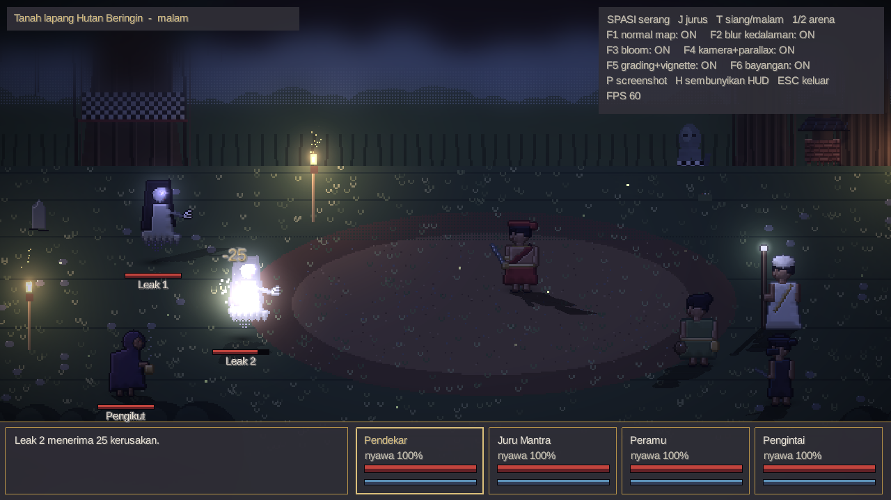
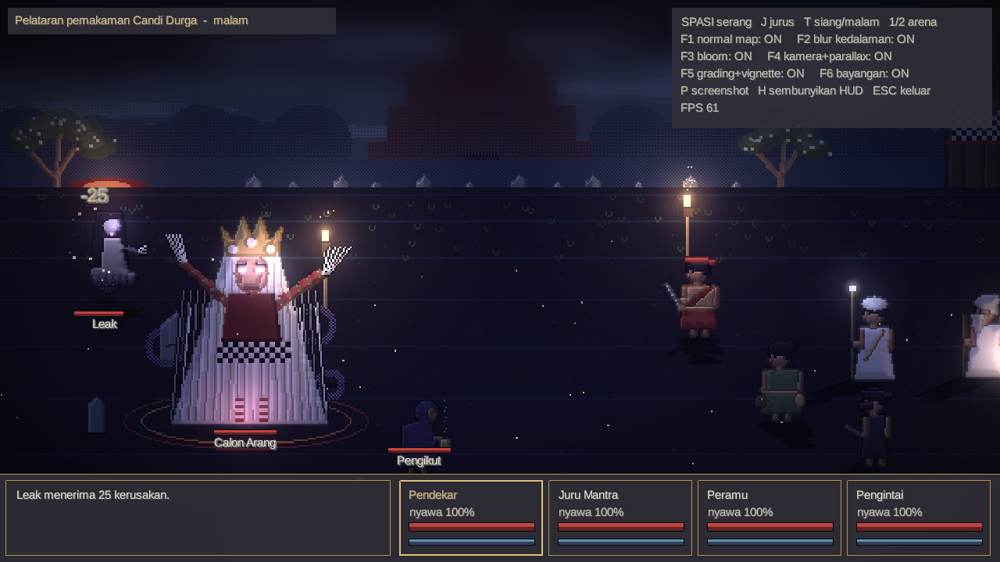

# Prototipe Arena 2.5D — Calon Arang: Bayang-Bayang Girah

Prototipe ini dibuat untuk **menilai rasa visual 2.5D langsung di dalam game** (bukan dari
gambar diam). Isinya satu layar battle dengan dua arena: tanah lapang Hutan Beringin
(siang/malam) dan pelataran pemakaman Candi Durga (malam).

> Semua gambar di `assets/` masih **sementara** (dibuat otomatis dengan kode). Yang dinilai
> adalah teknik dan suasananya; sprite dan latar akan diganti asset buatan kelompok.
> Logika battle sungguhan ada di backend (`id.girah.battle.BattleManager`); serangan di sini
> hanya pertunjukan visual.

| Hutan Beringin, malam | Hutan Beringin, siang | Pemakaman Candi Durga |
|---|---|---|
|  |  |  |

## Alur permainan

`./gradlew :lwjgl3:run` tanpa argumen membuka **layar judul** (latar Desa Girah saat senja). **Mulai** memutar
adegan pembuka Babak 1 di Balai Kerajaan Daha; begitu naskahnya selesai, game masuk ke battle di Hutan
Beringin (diatur oleh `"then": "hutan"` di naskah). **Lanjut** belum aktif (belum ada simpanan),
**Pengaturan** menyalakan/mematikan efek kamera. Argumen `--arena`, `--story`, atau `--demo` melewati
layar judul; `--title` memaksanya tampil.

## Cara menjalankan

Prototipe sudah **disatukan ke proyek utama**: kode tampilan ada di `core/src/main/java/id/girah/proto`,
launcher di `lwjgl3/`, dan semua asset di `assets/` di **root** repo. Jalankan dari **root** repo
(bukan lagi dari folder ini). Butuh Java 17 atau lebih baru.

```bash
./gradlew :lwjgl3:run
```

Di Windows **PowerShell** (wajib pakai `.\` di depan):

```bash
.\gradlew.bat :lwjgl3:run
```

Di Windows **Command Prompt (cmd)**:

```bash
gradlew.bat :lwjgl3:run
```

Pertama kali dijalankan, Gradle dan LibGDX akan diunduh otomatis (butuh internet).
`./gradlew build` membangun semuanya sekaligus menjalankan test back end.

Argumen tambahan, contoh: `./gradlew :lwjgl3:run --args="--arena pemakaman --demo"`

Folder `prototype-2.5d/` sekarang hanya berisi `tools/` (alat Python untuk asset), `screenshots/`,
dan README ini. **Semua perintah `python` di bawah dijalankan dari root repo.**

## Pertarungan sungguhan (back end)

Arena battle (`hutan`, `pemakaman`) sekarang memakai `BattleManager` dari back end
(`core/src/main/java/id/girah/proto/BattleSession.java`, mengikuti `docs/panduan-integrasi-backend.md`):

- Pengelana dan musuh dibuat dari tokoh di `arena.json` (kecocokan sprite dicek dengan `getIdSprite()`).
  Ratna dan Mpu Bharadah belum punya kelas back end, jadi hanya hiasan (catatan D2).
- Menu: **Serang**, **Jurus**, **Pusaka** (Tirta Suci, Kembang Kantil). Tombol nonaktif mengikuti aturan
  back end, misalnya Jurus Peramu hanya aktif jika ada kawan yang terluka.
- Setiap aksi (pemain atau AI) diputar dari event `onAksi`: maju jika jaraknya `DEKAT`, angka kerusakan dan
  pemulihan dari back end, nyawa di HUD baru berkurang pada frame benturan, animasi gugur.
- Narasi tampil baris demi baris dari `AntreanDialog`; `Enter` mempercepatnya. AI musuh menunggu sampai
  animasi dan narasi selesai (`izinkanBertindak`), dan menampilkan "..." saat berpikir.
- Akhir pertarungan: Babad diekspor ke `assets/babad/`. **KALAH** → `Enter` mengulang pertarungan;
  **MENANG** / **WAKTU HABIS** → `Enter` kembali ke layar judul (naskah lanjutan belum ada, catatan D6).
- Calon Arang berganti ke wujud ritual saat nyawanya ≤ 30% (hanya tampilan; back end belum punya wujud
  kedua, catatan D4).

Mode lama tanpa back end (tombol pamer efek E, K, X, G, SPASI, J) masih ada lewat `--pamer`.

| Argumen | Arti |
|---|---|
| `--arena hutan\|pemakaman` | Arena awal |
| `--mode day\|night` | Waktu awal (arena hutan punya keduanya) |
| `--demo` | Kedua pihak dimainkan otomatis |
| `--pamer` | Mode pamer lama tanpa back end |
| `--shot file.png --frames N` | Simpan screenshot pada frame N lalu keluar |
| `--attack-at N` / `--jurus-at N` | Pengelana yang bergiliran menyerang / memakai jurus pada frame N |
| `--title` / `--no-title` | Paksa tampil / lewati layar judul |
| `--start-at N` / `--story-end-at N` | Uji: tekan Mulai pada frame N / selesaikan naskah pada frame N |
| `--cepat` | Uji: AI musuh berpikir lebih singkat |
| `--keluar-saat-selesai` | Uji: keluar saat hasil pertarungan tampil (dengan `--shot`: screenshot hasil) |
| `--tekan Down,Enter,...` | Uji: tombol yang "ditekan" berurutan setiap kali menu/hasil terbuka |
| `--uji-bos-lemah` / `--shot-berubah f.png` | Uji: nyawa bos dikurangi di awal / screenshot saat bos berubah wujud |
| `--fx-at N`, `--boss-down-at N`, dst. | Pemicu uji mode `--pamer` |

Contoh uji satu pertarungan penuh: `./gradlew :lwjgl3:run --args="--arena hutan --demo --cepat --keluar-saat-selesai"`.

## Tombol

| Tombol | Fungsi |
|---|---|
| Panah atas/bawah, `Enter` (atau `Z`) | Menu aksi melayang (Serang, Jurus, Pusaka) untuk pengelana yang bergiliran |
| Panah, `Enter`, `Backspace` (atau `X`) | Pilih sasaran / pusaka, pakai, kembali |
| `Enter` saat narasi | Percepat narasi |
| `Enter` di panel hasil | KALAH: ulangi · MENANG: layar judul |
| `F12` | Tampilkan/sembunyikan daftar tombol |
| `C` | Putar contoh layar cerita (`assets/cerita/contoh_babak2.json`) |
| `T` | Ganti siang/malam (arena hutan) |
| `1` / `2` | Ganti arena (pertarungan baru) |
| `F1` – `F6` | Nyalakan/matikan: normal map, blur kedalaman, bloom, kamera + parallax, grading + vignette, bayangan |
| `P` | Simpan screenshot ke `screenshots/` |
| `H` | Sembunyikan HUD |
| `ESC` | Keluar |
| `SPASI`, `J`, `K`, `X`, `E`, `G` | Hanya di `--pamer`: serang cepat, mantra, jurus Pendekar, Pendekar diserang, pamer efek, gugur/bangkit |

**Cara menilai:** matikan efek satu per satu dengan `F1`–`F6` untuk melihat sumbangan
masing-masing terhadap rasa 2.5D, lalu nyalakan lagi.

## Apa saja yang membuat 2.5D

| Teknik | Di mana | Keterangan |
|---|---|---|
| Lapisan + parallax | `ArenaPrototype.useLayerCamera` | Langit, latar jauh, latar tengah, tanah, lapisan depan bergerak dengan kecepatan berbeda |
| Kamera diorama | `CameraRig` | Bergoyang pelan, mendekat saat aksi, bergetar saat serangan kena |
| Cahaya dengan normal map | `assets/shaders/lit.frag` | Obor, mata leak, tongkat Juru Mantra, dan kilatan serangan menerangi sprite sesuai bentuknya |
| Bayangan jatuh | `ArenaPrototype.drawShadows` | Sprite dipipihkan & dimiringkan menjauhi cahaya terdekat (atau matahari) |
| Blur kedalaman | `composite.frag` | Bagian atas (jauh) dan bawah (dekat kamera) layar diburamkan, tengah tajam |
| Bloom | `bright.frag` + `blur.frag` | Sumber cahaya "bersinar" |
| Color grading + vignette | `composite.frag` | Warna redup sesuai brief, tepi layar gelap |
| Partikel | `ParticleSystem` | Kunang-kunang, debu cahaya, abu dupa, bara obor, percikan serangan |

Urutan gambar tiap frame: scene → `FrameBuffer` 1280×720 (pixel art diperbesar 2×) →
blur kedalaman + bloom + grading → layar → HUD (tanpa efek).

## Struktur

```
(root repo)
├── assets/                    working directory game (dipakai lwjgl3:run)
│   ├── arena/<nama>/          arena.json + lapisan latar (+ *_n.png normal map)
│   ├── sprites/  potret/  fx/  ui/  fonts/  cerita/
│   └── shaders/               lit.frag, bright.frag, blur.frag, composite.frag, sprite.vert
├── core/src/main/java/id/girah/
│   ├── proto/                 kode tampilan (ArenaPrototype, Hud, StoryLayer, TitleLayer, ...)
│   └── ai/ battle/ karakter/ pusaka/ io/   back end (milik tim back end)
├── lwjgl3/src/main/java/id/girah/proto/Launcher.java   main + konfigurasi jendela
└── prototype-2.5d/
    ├── tools/                 alat Python asset (jalankan dari root repo)
    └── screenshots/
```

## Mengganti asset sementara dengan asset buatan kelompok

1. Gambar sprite di Pixelorama/LibreSprite dengan palet `docs/art/palette-girah.gpl`, ukuran
   sesuai brief (tokoh 64×64, kaki 3 px di atas tepi bawah kanvas).
2. Simpan dengan **nama file yang sama**, misalnya `assets/sprites/pendekar.png`.
   Untuk animasi idle, simpan setiap frame sebagai `<nama>_idle_0.png`, `<nama>_idle_1.png`, … —
   jika file `_idle_0.png` ada, prototipe otomatis memutar semua frame (0,2 detik per frame) dan
   mengabaikan `<nama>.png`. Contoh: `pendekar_idle_0.png` … `pendekar_idle_3.png` (dibuat dengan
   Codixel, sumbernya di `codixel-work/pendekar/`).
   Animasi aksi memakai pola yang sama: `<nama>_serang_0.png`, `<nama>_jurus_0.png`,
   `<nama>_terluka_0.png`, `<nama>_gugur_0.png`, ... (lama frame: serang 0,09 s, jurus 0,1 s,
   terluka 0,1 s, gugur 0,14 s). Tokoh tanpa file aksi tetap memakai pose diamnya.
3. Buat normal map-nya:
   - cepat: `python prototype-2.5d/tools/make_normals.py assets/sprites/pendekar.png`
   - lebih bagus: pakai **Laigter** (gratis), ekspor sebagai `pendekar_n.png`.
     Pastikan arah hijau (Y) menghadap **ke atas**; kalau cahaya terlihat terbalik atas-bawah,
     balik channel hijau di Laigter.
4. Lapisan latar: kanvas **720×380** (layar 640×360 + kelonggaran 40 px kiri-kanan dan 10 px
   atas-bawah). Posisi tokoh, obor, dan lampu diatur di `arena.json` dengan koordinat layar
   640×360 (y ke bawah).
5. Jalankan ulang `./gradlew :lwjgl3:run` dari root repo.

Menjalankan `python prototype-2.5d/tools/gen_assets.py` akan **menimpa** semua asset di `assets/arena` dan
`assets/sprites` dengan versi sementara. Jangan jalankan setelah asset asli dimasukkan.

## Latar arena dari gambar AI

Lapisan latar dibuat AI per lapisan (langit siang/malam, jauh, tengah, tanah, depan; bagian kosong
berwarna magenta #FF00FF), lalu diubah ke ukuran 720×380 dan palet game:

```bash
python prototype-2.5d/tools/bg_pixelize.py "referensi asset/latar arena/Hutan Beringin/hutan-tengah.jpeg" assets/arena/hutan/mid.png --ramps Daun,Tanah,Batu,Bayangan,Jerami,Putih --anchor bottom --key ff00ff
python prototype-2.5d/tools/make_normals.py assets/arena/hutan/mid.png
```

`--key ff00ff` membuat magenta transparan, `--fit width --top Y` menaruh gambar lebar mulai baris Y,
`--anchor top|center|bottom` memotong gambar yang lebih tinggi dari lapisan. Urutan gambar lapisan
mengikuti urutan `layers` di `arena.json` (di hutan: jauh, tanah, lalu pohon beringin di atas tanah).
Lapisan sementara yang lama disimpan di `codixel-work/latar/placeholder/`.

Bila AI mengisi bagian tengah lapisan tengah dengan kabut, semak, atau cahaya bulan (seperti di
pemakaman), bersihkan dulu dengan `tools/bg_sides.py` (menghapus pixel kebiruan/keunguan di tengah
dan mendorong pemandangan ke kedua sudut), lalu baru `bg_pixelize.py`. Lingkaran ritual di bawah
Calon Arang digambar dengan kode langsung di `ground.png` pada posisi tokohnya.

## HUD dan menu battle

`Hud` menggambar UI di skala pixel 640×360 dengan font **monogram** (CC0, `assets/fonts/`, butuh
`gdx-freetype`): kotak narasi, kartu status (ikon, nyawa, energi), nama + nyawa musuh, ronde, urutan
giliran, menu aksi melayang, penunjuk sasaran, dan angka kerusakan (kuning) / pemulihan (hijau).
Bingkai panel, kursor, dan ikon wajah dibuat dengan `python prototype-2.5d/tools/make_ui.py` (ikon diambil dari frame
idle pertama tiap sprite) ke `assets/ui/`. Jurus memakai 30% energi; Pusaka belum aktif. Logika
kerusakan di sini hanya pertunjukan: nanti diganti `BattleManager` di backend.

## Layar cerita dan dialog

`StoryLayer` (brief C7) menggambar di atas diorama arena: latar digelapkan, potret setengah badan di
kiri, kotak dialog miring, papan nama emas, judul babak (merah) dan misi di atas, serta pilihan berupa
panel miring bertumpuk. Teks muncul huruf demi huruf; `Enter` pertama menyelesaikan baris.

Naskah: `assets/cerita/<nama>.json` berisi `title`, `mission`, `arena` (lokasi, folder di
`assets/arena/`, misalnya `tapak_wangi`), dan `lines`. Setiap baris
`{"who": "ratna", "name": "Ratna Manggali", "face": "sedih", "text": "..."}`; `"who": "narator"` tanpa
potret. Pilihan: `{"choice": ["A", "B"], "replies": [[baris jika A], [baris jika B]]}`. Potret dicari di
`assets/potret/<who>_<face>.png` (128×192, menghadap kanan); bila belum ada dipakai sprite tokoh
diperbesar sebagai pengganti sementara. Uji: `--story contoh_babak2 --story-line 4`.

Naskah dibaca dan dijalankan oleh **back end** (`PembacaNaskah`, `PemutarNaskah`, `StatusCerita`,
panduan integrasi bagian 11). Format lengkap untuk penulis naskah, termasuk **`efek`** pilihan
(kepercayaan Ratna/warga, penanda keputusan) dan **`syarat`** baris/opsi, ada di
[`docs/format-naskah.md`](../docs/format-naskah.md). Perubahan nilai setelah memilih muncul sebentar di
kanan atas ("Kepercayaan Ratna +1"). `"then"` boleh berisi arena pertarungan **atau** nama naskah
berikutnya. `./gradlew test` memeriksa semua naskah di `assets/cerita/`. Uji pilihan:
`--story contoh_babak2 --story-end-at 30 --pilih 0` (0 = opsi pertama).

Potret dari AI (pixel art setengah badan, latar polos) diubah dengan:

```bash
python prototype-2.5d/tools/portrait.py "referensi asset/potret/ratna-netral.jpeg" assets/potret/ratna_netral.png --ramps Bayangan,Kulit,Putih,Jerami,Senja,Emas,Batu --sat-weight 20000 --height 85 --scale 2
```

Alat ini memakai grid dan palet yang sama dengan `normalize_ai_pixel.py`, memperbesar dengan kelipatan
bulat supaya pixel tetap persegi, dan menaruh badan di tepi bawah kanvas 128×192. Pakai selalu
`--height 85 --scale 2` supaya semua potret punya ukuran pixel yang sama (AI kadang memakai kotak
pixel yang berbeda). Latar diambil dari baris paling atas gambar, karena badan terpotong di bawah.

## Arena battle dari adegan utuh

Arena Hutan Beringin dan Pemakaman memakai cara yang sama dengan latar cerita: adegan utuh + langit +
latar jauh yang dibuat ulang AI dari adegan utuh. Bagian tengah adegan dibuka dengan
`tools/bg_window.py utuh jauh langit utama.png --rect x0,y0,x1,y1` (hanya di dalam persegi yang tidak
memotong batang pohon atau bangunan), lalu `bg_pixelize.py`. Lapisan lama disimpan di
`codixel-work/latar/placeholder/v1_*`.

## Latar layar cerita

Lokasi cerita disimpan seperti arena (`assets/arena/<lokasi>/arena.json`, tanpa musuh). Cara membuat
yang paling rapi: minta AI **satu adegan utuh**, lalu lapisan **langit** dan **latar jauh** yang
disalin dari adegan itu. Bangunan dan tanah dipotong langsung dari adegan utuh:

```bash
python prototype-2.5d/tools/bg_from_scene.py utuh.jpeg jauh.jpeg langit.jpeg utama.png --base 452
python prototype-2.5d/tools/bg_pixelize.py utama.png assets/arena/tapak_wangi/ground.png --key ff00ff --sat 1.6 --contrast 1.1 --ramps ...
```

Untuk ruangan yang hanya terlihat ke luar lewat celah (Balai Kerajaan Daha), latar jauh dibuat AI dari
adegan utuh (posisi sama persis), lalu pendopo dipotong hanya di dalam celah antar-tiang; pelita di gambar
dijadikan `staticLights` di `arena.json` supaya ikut menerangi tokoh. Contoh: `--story contoh_babak1`.

`--base` = baris tempat bangunan menapak di gambar utuh. `--sat` / `--contrast` menaikkan warna
gambar AI yang berkabut sebelum dicocokkan ke palet (Desa Tapak Wangi memakai 1.6 / 1.1).

## Efek serangan dan jurus

Efek dibuat dengan kode (Codixel) di `codixel-work/fx/` (`effects.js`, `tebasan.js`; jalankan
`node effects.js [nama]`), lalu frame-nya disalin ke `assets/fx/<nama>_<i>.png`. `FxPlayer` memutarnya
sekali jalan di posisi sasaran. Titik jangkar, lama frame, dan lapisan (di bawah atau di depan tokoh)
tiap efek diatur di konstruktor `FxPlayer`.

| Efek | Dipakai saat |
|---|---|
| `sabetan` | serangan biasa (SPASI, juga Pengikut menyerang) |
| `tebasan` | jurus Pendekar (`K`) |
| `lingkar_suci` | jurus Juru Mantra (`J`), di tanah di bawah musuh |
| `cakar` | serangan Leak dan Calon Arang wujud ritual |
| `ramuan_penawar`, `langkah_bayangan`, `doa_ratna`, `lingkar_perlindungan`, `asap_wabah`, `jerat_kabut`, `kutukan` | jurus tokoh lain (tombol `E`) |

## Memakai pixel art buatan AI

Gambar "pixel art" dari AI image generator hanya terlihat seperti pixel art: ukuran kotaknya bukan
bilangan bulat dan berubah tiap gambar, warnanya ratusan, latarnya tidak transparan, dan tinggi
tokohnya acak. Selalu lewatkan dulu ke alat penyeragaman:

```bash
python prototype-2.5d/tools/normalize_ai_pixel.py "referensi asset/karakter/Leak/leak-idle-ai.jpg" assets/sprites/leak.png --ramps Bayangan,Batu,Putih,Girah
```

Alat ini mengukur grid pixel, mengambil warna dari tengah tiap kotak, menghapus latar, mencocokkan
warna ke palet (boleh dibatasi ke ramp tertentu dengan `--ramps`), menyamakan tinggi tokoh
(`--height`, bawaan 50 px), menaruhnya di kanvas 96×64 dengan ujung bawah di baris 60, lalu membuat
normal map. Pakai `--mirror` untuk pengelana (menghadap kiri) dan `--preview file.png` untuk melihat
perbandingannya. Jika ada sisa latar, naikkan `--bg-tol`.

Detail kecil bisa hilang saat diperkecil (setiap pixel baru mengambil warna terbanyak):
`--keep-ink 0.25` mempertahankan garis tepi gelap (misalnya tangan di depan dada) dan
`--keep-bright 0.12` mempertahankan titik cahaya/kilau (misalnya ujung tongkat Juru Mantra).
Tokoh tinggi (bertongkat) memakai `--canvas-h 80`. Pakai `--min-hole 99999` bila tokohnya berkain
putih, supaya kain tidak dianggap lubang latar. Perbaikan pixel yang tetap perlu tangan manusia
disimpan per pose di `codixel-work/<tokoh>/touchup.py`.

Tokoh bertongkat bercahaya boleh punya `assets/sprites/<nama>_staff.json` berisi posisi ujung tongkat
per frame (`{"idle": [[60, 20], ...], "terluka": [null, null]}`; `null` = cahaya padam), supaya
lampunya ikut bergerak bersama tongkat. Tanpa file itu dipakai `staff` dari `arena.json`.

Bos bisa punya wujud kedua: tambahkan `"nextForm": {"name": ..., "sprite": ..., "eyes": [...]}` pada
tokoh di `arena.json`. Saat nyawanya habis, animasi `gugur` wujud pertama diputar (untuk Calon Arang:
berlutut dan mulai berubah), lalu tokoh diganti wujud kedua dengan nyawa penuh (fase 2).

Animasi aksi boleh punya `assets/sprites/<nama>_<anim>_timing.json`, misalnya
`{"durations": [0.16, 0.05, 0.12, 0.08, 0.10], "impact": 2}`: lama tiap frame (antisipasi ditahan,
smear sangat cepat, benturan ditahan) dan frame benturan. Kerusakan, kilatan, dan hit-stop singkat
(animasi hampir membeku 0,07 s; 0,12 s untuk serangan besar) muncul tepat di frame benturan itu.
Semua tokoh sudah memakainya: Pendekar lewat `codixel-work/pendekar/ai/smear.py`, tokoh lain lewat
`tools/smear_attack.py` (jejak arc / claw / thrust / none) yang dijalankan semua sekaligus dengan
`bash ../codixel-work/serang-smear.sh --install ../assets/sprites` (dari folder `prototype-2.5d`).

Warna cahaya mata bisa diatur per tokoh dengan `"eyeColor": [r, g, b]` (0–1) di `arena.json`;
bawaannya ungu pucat seperti mata leak. Wujud ritual Calon Arang memakai merah.

Setelah mengganti sprite yang punya mata menyala (misalnya leak), perbarui `eyes` di `arena.json`
(koordinat pixel mata di sprite) supaya lampu matanya pas.

## Langkah berikutnya

- Ganti sprite dan latar dengan asset buatan kelompok, mulai dari style board (brief bagian D).
- Sprite beranimasi (idle/serang/terluka) — sekarang hanya satu frame per tokoh.
- Hubungkan ke backend: `BattleManager` + `BattleListener` menggantikan aksi pertunjukan di
  `ArenaPrototype.startAction`. Backend perlu event "siapa melakukan apa" (lihat brief bagian E).
- Font pixel dan HUD sesuai brief (sekarang font bawaan LibGDX).
- Lapisan kabut bergerak dan berkas cahaya yang lebih halus.
