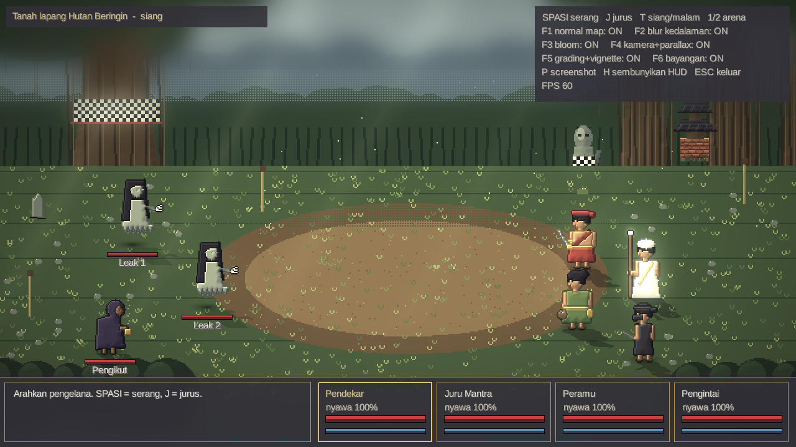

# Prototipe Arena 2.5D — Calon Arang: Bayang-Bayang Girah

Prototipe ini dibuat untuk **menilai rasa visual 2.5D langsung di dalam game** (bukan dari
gambar diam). Isinya satu layar battle dengan dua arena: tanah lapang Hutan Beringin
(siang/malam) dan pelataran pemakaman Candi Durga (malam).

> Semua gambar di `assets/` masih **sementara** (dibuat otomatis dengan kode). Yang dinilai
> adalah teknik dan suasananya; sprite dan latar akan diganti asset buatan kelompok.
> Logika battle sungguhan ada di backend (`id.girah.battle.BattleManager`); serangan di sini
> hanya pertunjukan visual.

| Hutan Beringin, malam | Hutan Beringin, siang | Pemakaman Candi Durga |
|---|---|---|
|  |  |  |

## Cara menjalankan

Butuh Java 17 atau lebih baru. Dari folder `prototype-2.5d/`:

```bash
./gradlew run
```

Di Windows **PowerShell** (wajib pakai `.\` di depan):

```bash
.\gradlew.bat run
```

Di Windows **Command Prompt (cmd)**:

```bash
gradlew.bat run
```

Pertama kali dijalankan, Gradle dan LibGDX akan diunduh otomatis (butuh internet).

Argumen tambahan, contoh: `./gradlew run --args="--arena pemakaman --demo"`

| Argumen | Arti |
|---|---|
| `--arena hutan\|pemakaman` | Arena awal |
| `--mode day\|night` | Waktu awal (arena hutan punya keduanya) |
| `--demo` | Serangan dan jurus berjalan otomatis |
| `--shot file.png --frames N` | Simpan screenshot pada frame N lalu keluar |
| `--attack-at N` / `--jurus-at N` | Picu serangan/jurus pada frame N |
| `--fx-at N` / `--fx-skip i` | Uji: putar pamer efek ke-i (0–7) pada frame N |
| `--boss-down-at N` | Uji: nyawa bos habis pada frame N (Calon Arang berubah ke wujud ritual) |

## Tombol

| Tombol | Fungsi |
|---|---|
| `SPASI` | Pengelana yang aktif menyerang |
| `J` | Juru Mantra memakai Mantra Lingkar Suci (animasi jurus, cahaya tongkat ikut bergerak) |
| `K` | Pendekar memakai jurus Tebasan Keris Pusaka (animasi jurus) |
| `X` | Musuh menyerang Pendekar (animasi terluka) |
| `E` | Pamer efek jurus: setiap tekan memutar jurus tokoh berikutnya (Peramu, Pengintai, Ratna, Bharadah, Pengikut, Pemimpin Pengikut, Calon Arang, Leak) beserta efeknya |
| `G` | Pendekar gugur / bangkit lagi (animasi gugur, frame terakhir ditahan) |
| `T` | Ganti siang/malam (arena hutan) |
| `1` / `2` | Ganti arena |
| `F1` – `F6` | Nyalakan/matikan: normal map, blur kedalaman, bloom, kamera + parallax, grading + vignette, bayangan |
| `P` | Simpan screenshot ke `screenshots/` |
| `H` | Sembunyikan HUD |
| `ESC` | Keluar |

**Cara menilai:** matikan efek satu per satu dengan `F1`–`F6` untuk melihat sumbangan
masing-masing terhadap rasa 2.5D, lalu nyalakan lagi.

## Apa saja yang membuat 2.5D

| Teknik | Di mana | Keterangan |
|---|---|---|
| Lapisan + parallax | `ArenaPrototype.useLayerCamera` | Langit, latar jauh, latar tengah, tanah, lapisan depan bergerak dengan kecepatan berbeda |
| Kamera diorama | `CameraRig` | Bergoyang pelan, mendekat saat aksi, bergetar saat serangan kena |
| Cahaya dengan normal map | `assets/shaders/lit.frag` | Obor, mata leak, tongkat Juru Mantra, dan kilatan serangan menerangi sprite sesuai bentuknya |
| Bayangan jatuh | `ArenaPrototype.drawShadows` | Sprite dipipihkan & dimiringkan menjauhi cahaya terdekat (atau matahari) |
| Blur kedalaman | `composite.frag` | Bagian atas (jauh) dan bawah (dekat kamera) layar diburamkan, tengah tajam |
| Bloom | `bright.frag` + `blur.frag` | Sumber cahaya "bersinar" |
| Color grading + vignette | `composite.frag` | Warna redup sesuai brief, tepi layar gelap |
| Partikel | `ParticleSystem` | Kunang-kunang, debu cahaya, abu dupa, bara obor, percikan serangan |

Urutan gambar tiap frame: scene → `FrameBuffer` 1280×720 (pixel art diperbesar 2×) →
blur kedalaman + bloom + grading → layar → HUD (tanpa efek).

## Struktur

```
prototype-2.5d/
├── assets/
│   ├── arena/<nama>/      arena.json + lapisan sky/far/mid/ground/front (+ *_n.png normal map)
│   ├── sprites/           sprite tokoh 64×64 (Calon Arang 128×128) + normal map
│   └── shaders/           lit.frag, bright.frag, blur.frag, composite.frag, sprite.vert
├── src/main/java/id/girah/proto/
│   ├── Launcher.java          main + konfigurasi jendela
│   ├── ArenaPrototype.java    loop utama, urutan gambar, aksi serangan
│   ├── ArenaData.java         membaca arena.json
│   ├── Actor25D.java          tokoh di bidang main
│   ├── PointLight.java        lampu (obor berkedip, kilatan sementara)
│   ├── CameraRig.java         kamera diorama
│   ├── ParticleSystem.java    partikel
│   ├── PostProcessor.java     efek kamera (FrameBuffer + shader)
│   ├── Hud.java               HUD sementara
│   └── Shaders.java           pemuat shader
├── tools/
│   ├── gen_assets.py      membuat ulang semua asset sementara
│   ├── make_normals.py    membuat normal map otomatis dari satu sprite
│   └── pixelkit.py, palette2.py   alat gambar pixel + palet 64 warna
└── screenshots/
```

## Mengganti asset sementara dengan asset buatan kelompok

1. Gambar sprite di Pixelorama/LibreSprite dengan palet `docs/art/palette-girah.gpl`, ukuran
   sesuai brief (tokoh 64×64, kaki 3 px di atas tepi bawah kanvas).
2. Simpan dengan **nama file yang sama**, misalnya `assets/sprites/pendekar.png`.
   Untuk animasi idle, simpan setiap frame sebagai `<nama>_idle_0.png`, `<nama>_idle_1.png`, … —
   jika file `_idle_0.png` ada, prototipe otomatis memutar semua frame (0,2 detik per frame) dan
   mengabaikan `<nama>.png`. Contoh: `pendekar_idle_0.png` … `pendekar_idle_3.png` (dibuat dengan
   Codixel, sumbernya di `codixel-work/pendekar/`).
   Animasi aksi memakai pola yang sama: `<nama>_serang_0.png`, `<nama>_jurus_0.png`,
   `<nama>_terluka_0.png`, `<nama>_gugur_0.png`, ... (lama frame: serang 0,09 s, jurus 0,1 s,
   terluka 0,1 s, gugur 0,14 s). Tokoh tanpa file aksi tetap memakai pose diamnya.
3. Buat normal map-nya:
   - cepat: `python tools/make_normals.py assets/sprites/pendekar.png`
   - lebih bagus: pakai **Laigter** (gratis), ekspor sebagai `pendekar_n.png`.
     Pastikan arah hijau (Y) menghadap **ke atas**; kalau cahaya terlihat terbalik atas-bawah,
     balik channel hijau di Laigter.
4. Lapisan latar: kanvas **720×380** (layar 640×360 + kelonggaran 40 px kiri-kanan dan 10 px
   atas-bawah). Posisi tokoh, obor, dan lampu diatur di `arena.json` dengan koordinat layar
   640×360 (y ke bawah).
5. Jalankan ulang `./gradlew run`.

Menjalankan `python tools/gen_assets.py` akan **menimpa** semua asset di `assets/arena` dan
`assets/sprites` dengan versi sementara. Jangan jalankan setelah asset asli dimasukkan.

## Efek serangan dan jurus

Efek dibuat dengan kode (Codixel) di `codixel-work/fx/` (`effects.js`, `tebasan.js`; jalankan
`node effects.js [nama]`), lalu frame-nya disalin ke `assets/fx/<nama>_<i>.png`. `FxPlayer` memutarnya
sekali jalan di posisi sasaran. Titik jangkar, lama frame, dan lapisan (di bawah atau di depan tokoh)
tiap efek diatur di konstruktor `FxPlayer`.

| Efek | Dipakai saat |
|---|---|
| `sabetan` | serangan biasa (SPASI, juga Pengikut menyerang) |
| `tebasan` | jurus Pendekar (`K`) |
| `lingkar_suci` | jurus Juru Mantra (`J`), di tanah di bawah musuh |
| `cakar` | serangan Leak dan Calon Arang wujud ritual |
| `ramuan_penawar`, `langkah_bayangan`, `doa_ratna`, `lingkar_perlindungan`, `asap_wabah`, `jerat_kabut`, `kutukan` | jurus tokoh lain (tombol `E`) |

## Memakai pixel art buatan AI

Gambar "pixel art" dari AI image generator hanya terlihat seperti pixel art: ukuran kotaknya bukan
bilangan bulat dan berubah tiap gambar, warnanya ratusan, latarnya tidak transparan, dan tinggi
tokohnya acak. Selalu lewatkan dulu ke alat penyeragaman:

```bash
python tools/normalize_ai_pixel.py "../referensi asset/karakter/Leak/leak-idle-ai.jpg" assets/sprites/leak.png --ramps Bayangan,Batu,Putih,Girah
```

Alat ini mengukur grid pixel, mengambil warna dari tengah tiap kotak, menghapus latar, mencocokkan
warna ke palet (boleh dibatasi ke ramp tertentu dengan `--ramps`), menyamakan tinggi tokoh
(`--height`, bawaan 50 px), menaruhnya di kanvas 96×64 dengan ujung bawah di baris 60, lalu membuat
normal map. Pakai `--mirror` untuk pengelana (menghadap kiri) dan `--preview file.png` untuk melihat
perbandingannya. Jika ada sisa latar, naikkan `--bg-tol`.

Detail kecil bisa hilang saat diperkecil (setiap pixel baru mengambil warna terbanyak):
`--keep-ink 0.25` mempertahankan garis tepi gelap (misalnya tangan di depan dada) dan
`--keep-bright 0.12` mempertahankan titik cahaya/kilau (misalnya ujung tongkat Juru Mantra).
Tokoh tinggi (bertongkat) memakai `--canvas-h 80`. Pakai `--min-hole 99999` bila tokohnya berkain
putih, supaya kain tidak dianggap lubang latar. Perbaikan pixel yang tetap perlu tangan manusia
disimpan per pose di `codixel-work/<tokoh>/touchup.py`.

Tokoh bertongkat bercahaya boleh punya `assets/sprites/<nama>_staff.json` berisi posisi ujung tongkat
per frame (`{"idle": [[60, 20], ...], "terluka": [null, null]}`; `null` = cahaya padam), supaya
lampunya ikut bergerak bersama tongkat. Tanpa file itu dipakai `staff` dari `arena.json`.

Bos bisa punya wujud kedua: tambahkan `"nextForm": {"name": ..., "sprite": ..., "eyes": [...]}` pada
tokoh di `arena.json`. Saat nyawanya habis, animasi `gugur` wujud pertama diputar (untuk Calon Arang:
berlutut dan mulai berubah), lalu tokoh diganti wujud kedua dengan nyawa penuh (fase 2).

Warna cahaya mata bisa diatur per tokoh dengan `"eyeColor": [r, g, b]` (0–1) di `arena.json`;
bawaannya ungu pucat seperti mata leak. Wujud ritual Calon Arang memakai merah.

Setelah mengganti sprite yang punya mata menyala (misalnya leak), perbarui `eyes` di `arena.json`
(koordinat pixel mata di sprite) supaya lampu matanya pas.

## Langkah berikutnya

- Ganti sprite dan latar dengan asset buatan kelompok, mulai dari style board (brief bagian D).
- Sprite beranimasi (idle/serang/terluka) — sekarang hanya satu frame per tokoh.
- Hubungkan ke backend: `BattleManager` + `BattleListener` menggantikan aksi pertunjukan di
  `ArenaPrototype.startAction`. Backend perlu event "siapa melakukan apa" (lihat brief bagian E).
- Font pixel dan HUD sesuai brief (sekarang font bawaan LibGDX).
- Lapisan kabut bergerak dan berkas cahaya yang lebih halus.
